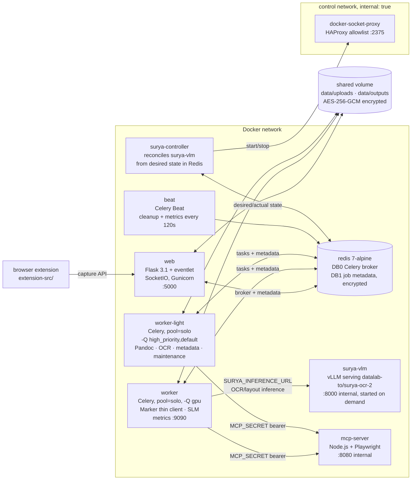
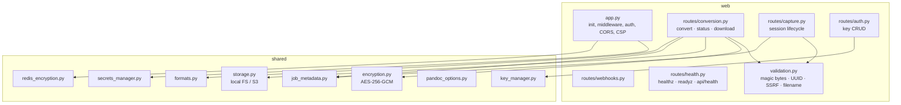
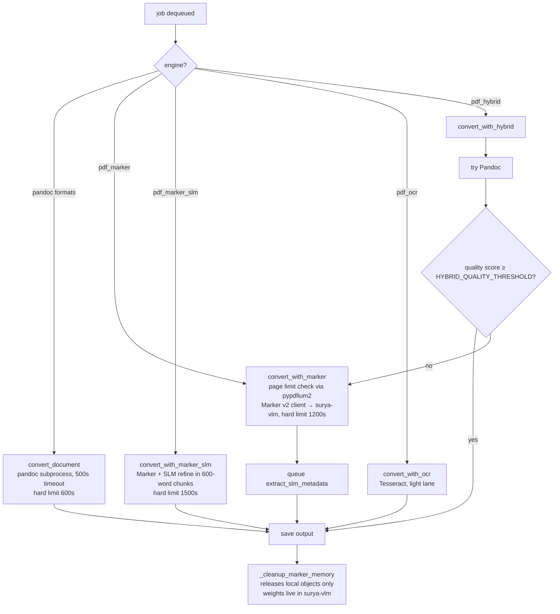
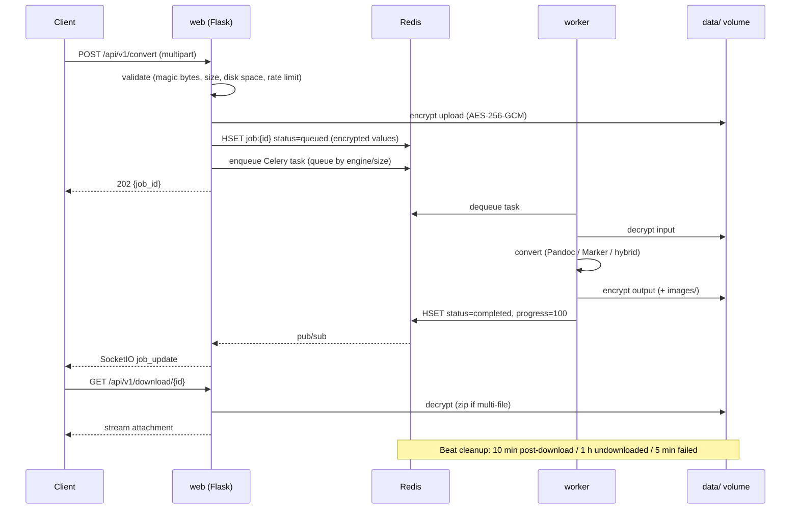
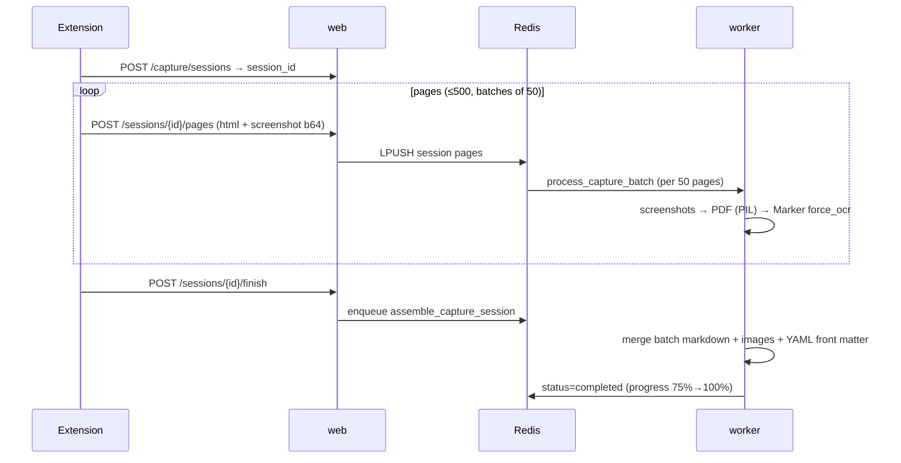
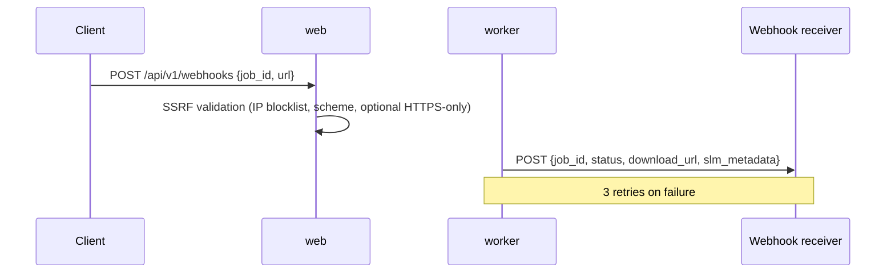
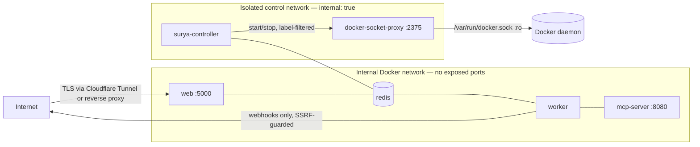

# DocuFlux — Architecture Document

**Status:** Current-state description · **Last updated:** 2026-10-22
**Related docs:** [PRD.md](PRD.md) · [BACKLOG.md](user-stories/BACKLOG.md) · [API.md](API.md) · [CONFIGURATION.md](CONFIGURATION.md) · [DEPLOYMENT.md](DEPLOYMENT.md) · [AI_INTEGRATION.md](AI_INTEGRATION.md)

This document describes the system as it exists today, including known gaps. Planned changes are referenced by their [BACKLOG.md](user-stories/BACKLOG.md) story IDs.

---

## 1. System Context (C4 Level 1)

```mermaid
flowchart TB
    subgraph Actors
        U[Browser User]
        A[API Client / Pipeline]
        E[Browser Extension<br/>Chrome / Firefox]
        G[LLM Agent<br/>MCP Consumer]
    end

    DF[DocuFlux Deployment<br/>document conversion service]

    subgraph External
        S3[(S3-compatible storage<br/>optional backend)]
        WH[Webhook Receivers]
        MS[Model Artifact Sources<br/>Surya OCR weights (surya-vlm)<br/>TinyLlama GGUF (worker)<br/>fetched at startup only]
        CF[Cloudflare Tunnel<br/>optional ingress]
    end

    U -->|HTTPS / WebSocket| DF
    A -->|REST API v1 + dk_ key| DF
    E -->|Capture API, CORS-scoped| DF
    G -->|MCP tools| DF
    DF -->|store/retrieve| S3
    DF -->|POST on job completion| WH
    MS -.->|fetched at build/startup| DF
    CF -.->|ingress| DF
```

Trust note: all conversion and metadata extraction is local. The only runtime egress is webhook delivery (SSRF-guarded, see §6.5).

---

## 2. Container View (C4 Level 2)

Nine runtime containers (the last two exist only for the Compose on-demand Surya lifecycle) plus the distributed browser extension:



### 2.1 `web` — Flask application (`web/`)

- Flask 3.1 with eventlet monkey-patching, Flask-SocketIO for real-time job updates, Gunicorn (eventlet worker class).
- Route blueprints: `routes/conversion.py` (convert/status/download), `routes/capture.py` (extension sessions), `routes/auth.py` (API keys), `routes/webhooks.py`, `routes/health.py`, `routes/admin_surya.py` (Surya lifecycle and OCR settings, see §7.3).
- Middleware: CSRF (Flask-WTF), rate limiting (Flask-Limiter backed by Redis), structured JSON logging with `X-Request-ID` correlation, ProxyFix behind `BEHIND_PROXY`.

### 2.2 `worker` — Celery worker (`worker/`)

- `pool=solo`, concurrency 1, `max_tasks_per_child=50`, `acks_late=True`, `reject_on_worker_lost=True`.
- Two Compose services share the `worker/` image code: `worker` is the heavy lane (`-Q gpu`: Marker, Marker+SLM, hybrid; reserves the NVIDIA device) and `worker-light` is the light lane (`-Q high_priority,default`: Pandoc, Tesseract OCR, SLM metadata, capture, maintenance; built with `BUILD_GPU=false`, no GPU). A long Marker job therefore no longer blocks Pandoc or maintenance tasks (Story 6.3).
- 15 tasks in the `worker/tasks/` package: `conversion.py` (`convert_document`, `convert_with_marker`, `convert_with_marker_slm`, `convert_with_hybrid`, `convert_with_ocr`), `capture.py` (`process_capture_batch`, `assemble_capture_session`, `analyze_screenshot_layout`, `agentic_page_turner`), `metadata.py` (`extract_slm_metadata`, `test_amazon_session`), `maintenance.py` (`cleanup_old_files`, `sweep_orphaned_temp_files`, `migrate_filesystem_jobs`, `update_metrics`).
- `warmup.py` detects GPU, eagerly loads the SLM, and probes the shared Surya inference server (`check_inference_server()`); Marker model weights live in the `surya-vlm` process — the worker is a thin client whose artifact dict is lazily created on first conversion (fast, ~1 s).
- Prometheus metrics on port 9090 (`metrics.py`).

### 2.3 `beat` — Celery Beat

- Schedules `cleanup_old_files` and `update_metrics` every 120 s and `sweep_orphaned_temp_files` every 900 s (`tasks/__init__.py`); all dispatched to the `default` queue (served by `worker-light`).

### 2.4 `redis` — broker and metadata store

- DB 0: Celery broker + result backend; DB 1: job metadata hashes (values encrypted via `shared/redis_encryption.py`), capture sessions, API keys, rate-limit counters, dead-letter queue (`dlq:tasks`).
- `requirepass`, 256 MB `maxmemory` with `noeviction`, AOF persistence. **TLS:** the base `docker-compose.yml` runs plaintext `redis://` on 6379 (internal network only, no published port). TLS is an opt-in overlay (`docker-compose.tls.yml`, see §6.3 and [CERTIFICATE_MANAGEMENT.md](CERTIFICATE_MANAGEMENT.md)). Sentinel HA supported via config.

### 2.5 `mcp-server` — Playwright automation (`mcp_server/`)

- Node.js HTTP server (internal port 8080) exposing browser actions; authenticated by `MCP_SECRET` bearer token; reachable only from the worker. Runs as `pwuser` with a container healthcheck (Backlog 4.5, done).

### 2.6 Browser extension (`extension-src/`)

- Chrome MV3 / Firefox MV2 manifests; DOMPurify for sanitization; Socket.IO client for progress; built via `scripts/build-extension.js`.

### 2.7 Inter-container contracts

| Contract | Definition |
|----------|------------|
| Celery task signatures | `tasks.convert_document`, `tasks.convert_with_marker`, `tasks.convert_with_marker_slm`, `tasks.convert_with_hybrid`, `tasks.convert_with_ocr`, `tasks.process_capture_batch`, `tasks.assemble_capture_session`, `tasks.extract_slm_metadata`, maintenance tasks (15 in total, §2.2) |
| Queue routing | Marker/SLM/hybrid → `gpu` queue (`worker`); Pandoc and Tesseract OCR (`pdf_ocr`) < 5 MB → `high_priority`, ≥ 5 MB → `default`; capture and maintenance → `default` (`worker-light`) |
| Redis key schema | `job:{uuid}` (hash), `capture:session:{uuid}`, `jobs:active`, `workers:status`, `dlq:tasks` |
| Worker→MCP | HTTP POST `http://mcp-server:8080/execute`, `Authorization: Bearer ${MCP_SECRET}` |
| Worker→inference server | Marker v2 thin client → `SURYA_INFERENCE_URL=http://surya-vlm:8000/v1` (the `/v1` suffix is load-bearing: surya uses it verbatim as the OpenAI base URL and strips it for the `/health` probe), `SURYA_INFERENCE_AUTOSTART=false`; server exposes internal port 8000 with `/health` |
| Controller→Docker | `surya-controller` → `DOCKER_HOST_URL=http://docker-socket-proxy:2375` over the `control` network; the only component that touches the Docker API (§7.3) |

---

## 3. Component View (C4 Level 3)

### 3.1 Web components



### 3.2 Worker engine selection



The hybrid fallback decision uses the Story 1.1 quality scorer: Pandoc output passes when its score meets the configured `HYBRID_QUALITY_THRESHOLD` (default 60), otherwise the job falls back to Marker (`_assess_pandoc_quality`, `worker/tasks/conversion.py`).

---

## 4. Data Flow Views

### 4.1 Standard conversion lifecycle



### 4.2 Browser capture assembly



### 4.3 Webhook delivery



### 4.4 Job metadata lifecycle (Redis DB 1)

States: `queued → in_progress → completed | failed`. Each `job:{uuid}` hash carries status, progress (0–100), stage, filenames, formats, engine, timestamps, and (post-Marker) SLM metadata — values encrypted at rest. TTLs and the Beat sweep enforce retention; failed tasks additionally land in `dlq:tasks` for inspection.

---

## 5. Deployment Topologies

### 5.1 Docker Compose variants

| File | Purpose | Key differences |
|------|---------|-----------------|
| `docker-compose.yml` | Base | redis, web, worker (heavy lane, `-Q gpu`), **worker-light** (`-Q high_priority,default`, no GPU), beat, mcp-server, **surya-vlm** (the base deployment is the GPU topology — the worker reserves an NVIDIA device, drains the `gpu` queue, and attaches to the inference server via `SURYA_INFERENCE_URL`), **surya-controller** and **docker-socket-proxy** (on-demand lifecycle of `surya-vlm`, see §7.3; the proxy and controller share the `internal: true` `control` network); hardening defaults (non-root, cap_drop ALL, no-new-privileges, noexec tmpfs) |
| `docker-compose.gpu.yml` | GPU overlay | worker 16–18 GB memory, NVIDIA device reservation, `MARKER_ENABLED=true`; same `surya-vlm` image/env/probes as base, gated behind the `gpu` profile |
| `docker-compose.cpu.yml` | CPU overlay | worker 2 GB memory, Marker disabled; `surya-vlm`, `surya-controller` and `docker-socket-proxy` are all moved to a never-activated profile, so CPU-only hosts neither allocate a GPU nor expose the host Docker socket to a proxy; run with `OCR_MODE=cpu_only` |
| `docker-compose.tls.yml` | Redis TLS overlay | Opt-in. Redis serves TLS only (`--port 0 --tls-port 6380`) and `web`, `worker` and `beat` switch to `rediss://…:6380` with `REDIS_TLS_CA_CERTS`. Requires `./scripts/generate-redis-certs.sh` first. **Does not yet cover `worker-light` or `surya-controller`**, which keep `redis://…:6379` and cannot reach a TLS-only Redis — see §6.3 |

There is no Cloudflare Compose overlay: `docker-compose.cloudflare.yml` was removed (#97). Tunnel ingress, if wanted, is run by the operator outside Compose; the helper files remain in `deploy/cloudflare/` and the old guide is kept, deprecated, at [archive/CLOUDFLARE_TUNNEL_SETUP.md](archive/CLOUDFLARE_TUNNEL_SETUP.md).

Build: `scripts/build.sh auto` detects GPU (`nvidia-smi`) and selects `BUILD_GPU`, which switches the worker base image (`nvcr.io/nvidia/cuda:12.2.2-cudnn8-devel-ubuntu22.04` vs `ubuntu:22.04`) and requirements file (`requirements-true.txt` ~15 GB vs `requirements-false.txt` <3 GB).

### 5.2 Kubernetes (`deploy/k8s/`)

Namespace, registry secret, Redis StatefulSet, web Deployment (2 replicas + HPA 1–10), worker Deployments (CPU and GPU variants + HPA), NetworkPolicies restricting inter-pod traffic. Manifests are not validated in CI (Backlog 5.4 adjacent). The on-demand `surya-vlm` lifecycle (§7.3) is **Compose-only**: Kubernetes keeps `surya-vlm` always-on (`replicas: 1`), with no controller or Docker socket; scale-to-zero on k8s is deferred.

### 5.3 Hardware capability matrix

| Capability | GPU profile | CPU profile |
|------------|-------------|-------------|
| Pandoc conversion | ✅ | ✅ |
| Marker PDF→Markdown | ✅ | ❌ |
| Scanned PDF (OCR) | ✅ (Marker; Surya loaded on demand) | Tesseract — the `cpu_only` path (`OCR_MODE=cpu_only`); Marker is not offered |
| SLM metadata | ✅ (GPU layers) | ✅ (slower) |
| Capture assembly (OCR path) | ✅ | ❌ degraded |

---

## 6. Security Architecture

### 6.1 Trust boundaries



### 6.2 Authentication & authorization

- **API keys:** `dk_`-prefixed, created/revoked via `/api/v1/auth/keys` under `ADMIN_API_SECRET` bearer auth; stored hashed (`shared/key_manager.py`); presented as `X-API-Key`. Keys expire after `API_KEY_DEFAULT_TTL_DAYS` (default 90) unless a per-key `expires_in_days` is given at creation. **Gap:** no per-key usage audit log.
- **Sessions:** `HTTPONLY`, `SameSite=Lax`; `SESSION_COOKIE_SECURE` opt-in (must be enabled behind HTTPS).
- **CSRF:** Flask-WTF on browser-facing routes.
- **MCP:** bearer-token (`MCP_SECRET`) on an internal-only endpoint.

### 6.3 Encryption

- **Files at rest:** AES-256-GCM with per-job DEKs wrapped by `MASTER_ENCRYPTION_KEY` (`shared/encryption.py`).
- **Redis payloads:** job metadata values encrypted (`shared/redis_encryption.py`).
- **Key sourcing:** Docker secrets → env vars → `.env` (`shared/secrets_manager.py`); fail-fast in production if absent; ephemeral keys auto-generated in dev.
- **Redis transport:** plaintext on the internal Docker network by default; the `docker-compose.tls.yml` overlay enables TLS-only Redis (6380) for `web`/`worker`/`beat` but not yet `worker-light` or `surya-controller` (§5.1). All Redis clients are built through `shared/redis_client.py`, which verifies the CA whenever the URL is `rediss://`; note `surya-controller` builds its own `redis.Redis.from_url` clients instead.
- **Gaps:** no documented `MASTER_ENCRYPTION_KEY` rotation procedure.

### 6.4 Input validation (`web/validation.py`)

UUID v4 validation, filename sanitization (path-traversal defense), magic-byte content checks (PDF `%PDF`, ZIP `PK`, text-encoding probes) cross-checked against a libmagic MIME sniff of the declared extension when `python-magic` is available, upload size and free-disk enforcement.

### 6.5 Network protections

- Rate limiting: Flask-Limiter (Redis-backed), defaults 1000/day + 200/hour, per-endpoint overrides on capture routes, and a dedicated `CONVERT_RATE_LIMIT` (default `200 per hour`) on the conversion endpoints.
- SSRF: webhook URLs validated against IP blocklists/schemes; optional HTTPS-only enforcement.
- CORS: capture endpoints only, restricted to extension origins.
- CSP: set in `app.py`; `script-src`/`style-src` do not use `unsafe-inline` (the one inline import-map script is allow-listed with a per-request nonce).

### 6.6 Container hardening

Non-root users in web and worker images; `cap_drop: [ALL]`; `no-new-privileges`; `tmpfs /tmp noexec,nosuid,nodev`; Redis unexposed and password-protected. `surya-controller` runs `read_only` with `cap_drop: [ALL]` and `no-new-privileges`; `docker-socket-proxy` drops all capabilities, runs a custom HAProxy allowlist (`deploy/docker-socket-proxy/haproxy.cfg.template`) that forwards only `GET /_ping`, `GET /containers/json` and `POST /containers/{id}/start|stop` (everything else, including `POST /containers/create` and exec, gets 403), drops all capabilities, and joins only the `internal: true` `control` network. **Residual risk:** the proxy still cannot scope start/stop to one container, so a compromised controller could stop or start any container on the host (availability impact); it can no longer create containers or exec, which closes the host-escape path found in DocuFlux-6b5 (see §7.3 and ADR-002a). `deploy/docker-socket-proxy/verify.sh` checks the allowlist against the real image. Base images are pinned by digest (Backlog 5.2, done) and the MCP container runs non-root with a healthcheck (Backlog 4.5, done).

### 6.7 OSCAL control mapping

`oscal/component-definition.json` and `oscal/ssp.json` map mechanisms to NIST SP 800-53 controls (AC-2/AC-3 → API keys, AU-2 → logging, SC-8 → transport encryption, SC-28 → encryption at rest), validated by `.github/workflows/oscal-validate.yml`. Closing Epic 4 gaps should update the corresponding SSP statements (Backlog 5.5).

---

## 7. Cross-Cutting Concerns

### 7.1 Observability

- **Logging:** web and worker tiers emit structured JSON via `shared/logging_config.py` (web with request-ID correlation, worker with job context).
- **Metrics:** Prometheus counters/histograms/gauges in `worker/metrics.py` (conversion totals/durations/failures, GPU utilization, queue depth) + `prometheus-flask-exporter` on web; Grafana dashboard in `docs/grafana-dashboard.json` and alert rules in `deploy/monitoring/alerts.yml` ([ALERTING.md](ALERTING.md)).
- **Healthchecks:** `/healthz`, `/readyz`, `/api/health` on web. The `worker` and `worker-light` Docker healthchecks run `celery inspect ping` against the container's own node; `beat` checks its process; `surya-vlm` polls vLLM `/health` (503 until the model is loaded).

### 7.2 Configuration

Single Pydantic Settings class (`config.py`); precedence Docker secrets → environment → `.env` → defaults; `SecretStr` for all credentials. Full reference: [CONFIGURATION.md](CONFIGURATION.md).

### 7.3 Model lifecycle

- Marker (v2, `marker-pdf 2.0.0`): the worker is a thin client attaching to the shared `surya-vlm` inference server via `SURYA_INFERENCE_URL` (`http://surya-vlm:8000/v1`; `SURYA_INFERENCE_AUTOSTART=false` — the deployment owns the server). A lazy `create_model_dict()` builds the client-side artifact dict on first conversion per worker process (~1 s; the ~30 s in-process weight load of v1 is gone); it is cached for the process's lifetime (recycled every 50 tasks via `max_tasks_per_child`). Model weights live in the server process, sized by `VLLM_GPU_MEMORY_UTILIZATION`.
- SLM (TinyLlama GGUF): eagerly loaded at worker start (`warmup.py`), GPU layers when available.
- GPU memory: `_cleanup_marker_memory()` after every Marker task releases only the worker's local objects (`gc.collect()`); `torch.cuda.empty_cache()` would act on a worker-local CUDA context that no longer holds model weights, so it is not used. Weights live in the `surya-vlm` process, whose VRAM footprint is managed server-side; `shutdown_marker_models()` at worker shutdown is a no-op when attached to a remote server. Residual risk (server-side state) is addressed by the recycling decision below.

#### Inference server recycling

**Decision:** recycle the shared `surya-vlm` server on a bounded deployment schedule and by idle unload; never from the worker.

Workers already recycle their own process every 50 tasks (`max_tasks_per_child=50`), but that only bounds worker-process memory. The shared vLLM server is a separate long-lived process, and [`docs/archive/marker_v2_REPORT.md`](archive/marker_v2_REPORT.md) observed one silent degeneration (a 14× repetition loop) on the tenth document of a sequential batch — evidence of state accumulating in the shared server rather than in the client. Worker-driven teardown is the wrong tool: many thin workers share one server, and `tests/unit/test_worker.py` pins that a completed conversion must NOT stop it.

**Mechanism:** Compose — `docker compose restart surya-vlm` on a schedule (e.g. daily cron/systemd timer); `restart: unless-stopped` recovers crashes. Kubernetes — `kubectl rollout restart deployment/surya-vlm -n docuflux` on a schedule; `restartPolicy: Always` recovers crashes. The output-quality bound (`excess_output` in `shared/quality.py`) is the first line of defense against a degenerate run, and periodic recycling bounds how long a silent degradation can persist. Rationale is pinned in-manifest in `docker-compose.yml` and `deploy/k8s/surya-vlm.yaml`.

**On-demand lifecycle (Compose only):** `surya-controller` is the **sole owner of start/stop** for `surya-vlm`; it reconciles the container against desired state held in Redis (`shared/surya_state.py`) every few seconds. "Never from the worker" still holds: the worker (and the web routes) only write desired state to Redis — they never touch the Docker API. Behaviour is selected by `OCR_MODE`:

- `on_demand` (default): a conversion that needs Marker requests a load; the worker waits up to `SURYA_COLD_START_TIMEOUT_SECONDS` (default 600) for the server to become healthy. After `SURYA_IDLE_TIMEOUT_MINUTES` (default 15) with no running or queued Marker work, the controller unloads it and VRAM is freed. An idle unload is also a recycle, so the server is restarted from a clean process on the next demand.
- `cpu_only`: Surya is never started and the controller forces desired state to `stopped`; scanned PDFs use Tesseract and Marker formats are hidden from the UI.

An admin can load or unload manually (`/api/v1/admin/surya`, `ADMIN_API_SECRET` bearer) and change mode and timeouts at runtime (`/api/v1/admin/ocr-settings`, stored in `settings:ocr` in Redis, seeded from the environment). A manual load **pins** the server so idle unload skips it until it is unloaded manually. Because the controller stops the container with `docker stop` and the service uses `restart: unless-stopped`, an `exited` `surya-vlm` is the normal idle state, not a failure.

---

## 8. Architecture Decision Records (retroactive)

### ADR-001: Eventlet + Flask-SocketIO for real-time updates
**Decision:** Use Flask with eventlet monkey-patching and Flask-SocketIO rather than an ASGI stack.
**Rationale:** WebSocket progress with minimal divergence from a conventional Flask app; Redis message queue lets multiple web replicas broadcast.
**Consequences:** Eventlet is in maintenance mode upstream; CSP needs a per-request nonce for the one inline script; future migration to gevent/threading or ASGI may be required (PRD §10).

### ADR-002: Celery `pool=solo`, concurrency 1
**Decision:** One task at a time per worker process. The Compose GPU worker keeps `--concurrency=1`; the Kubernetes GPU worker runs `--concurrency=2` since marker 2 (see ADR-002a).
**Rationale:** Marker and the SLM contend for a single GPU; serializing avoids VRAM exhaustion and CUDA context conflicts. `max_tasks_per_child=50` bounds memory creep.
**Consequences:** Head-of-line blocking — a 20-minute Marker job stalls Pandoc and maintenance tasks. Mitigation (shipped, Story 6.3): the `gpu` queue is drained only by the heavy-lane `worker`, while Pandoc, OCR, metadata and maintenance tasks run on `worker-light`. Marker jobs still queue behind each other.

### ADR-002a: Shared Surya VLM inference server (marker 2)
**Decision:** Marker 2 model weights live in a dedicated `surya-vlm` service (vLLM serving `datalab-to/surya-ocr-2`); workers attach via `SURYA_INFERENCE_URL=http://surya-vlm:8000/v1` with `SURYA_INFERENCE_AUTOSTART=false`.
**Rationale:** The VLM owns the GPU once, and many thin workers share it; workers hold no CUDA context for the VLM, so GPU worker concurrency can rise (2 in k8s) without multiplying VRAM.
**Consequences:** The inference server is a single point of failure for Marker — but *down is no longer always a failure*: in `on_demand` mode it is stopped when idle and started by the controller on the first Marker job (cold start latency up to `SURYA_COLD_START_TIMEOUT_SECONDS`); a job fails only if the load does not complete in that window, and in `cpu_only` mode Marker is not attempted. Per-task `torch.cuda.empty_cache()` no longer applies (see §7.3). The lifecycle adds a **control-plane dependency**: `surya-controller` → `docker-socket-proxy` → the host Docker socket. The proxy runs a custom HAProxy allowlist (`deploy/docker-socket-proxy/haproxy.cfg.template`) forwarding only `GET /_ping`, `GET /containers/json` and `POST /containers/{id}/start|stop`; all else is 403. It still cannot scope start/stop to one container, so only the controller's `com.docker.compose.service=surya-vlm` label filter and the `internal: true` `control` network limit which container a compromised controller can start or stop. **Resolved (DocuFlux-6b5):** the stock image's `CONTAINERS` ACL is the prefix regex `^(/v[\d\.]+)?/containers`, so under `POST=1` it also forwarded `POST /containers/create` and `POST /containers/{id}/exec` (a host-escape path); the custom template anchors each allowed route and denies the rest, verified against `tecnativa/docker-socket-proxy` 0.3.0 with `deploy/docker-socket-proxy/verify.sh`. **Remaining risk:** a compromised controller can still stop or start any container (denial of service). Mitigations: no host port, isolated network, `cap_drop: ALL`, read-only rootfs on the controller. A rootless Docker daemon would remove the residual.

### ADR-003: Redis as the only datastore
**Decision:** Job metadata, capture sessions, API keys, and rate limits all live in Redis; no RDBMS.
**Rationale:** Jobs are transient by design (retention minutes-to-hours); Redis already serves as Celery broker; one fewer stateful service to operate.
**Consequences:** No relational querying or long-term history; durability depends on AOF; `noeviction` at 256 MB means load spikes surface as write errors rather than silent data loss.

### ADR-004: Envelope encryption at rest
**Decision:** AES-256-GCM with per-job data-encryption keys wrapped by a master key, applied to files and Redis metadata values.
**Rationale:** Confidentiality on shared volumes and in Redis dumps; per-job DEKs limit blast radius; GCM provides integrity.
**Consequences:** Key management is the critical path (rotation undocumented); crypto code is held to per-module coverage floors (`pyproject.toml`); CPU overhead on every file touch.

### ADR-005: Hybrid engine with quality-score threshold
**Decision:** `pdf_hybrid` tries Pandoc first and falls back to Marker when the Story 1.1 quality scorer rates the output below `HYBRID_QUALITY_THRESHOLD` (default 60).
**Rationale:** Pandoc is orders of magnitude cheaper; only pay GPU cost when fast conversion visibly fails.
**Consequences:** The scorer catches degradation the old words/page count missed (mangled tables, shuffled columns, garbage characters). Marker 2 makes the fallback cheaper to run: the VLM server is already warm, so the first fallback no longer pays a ~30 s model load.

---

## 9. Known Limitations and Planned Evolution

The quality scoring, CPU OCR, light-lane worker and most hardening stories from [Backlog](user-stories/BACKLOG.md) Epics 1–6 have shipped; the limitations that remain are below.

| Limitation | Where | Notes / planned evolution |
|------------|-------|---------------------------|
| Kubernetes keeps `surya-vlm` always-on | `deploy/k8s/surya-vlm.yaml` | The on-demand lifecycle (§7.3) is Compose-only: no controller or Docker socket on k8s. Scale-to-zero on k8s is deferred. |
| `docker-socket-proxy` cannot scope start/stop to one container | `deploy/docker-socket-proxy/haproxy.cfg.template` | The allowlist forwards only `GET /_ping`, `GET /containers/json` and `POST /containers/{id}/start\|stop`, but a compromised controller could still stop or start any container on the host (availability only). Only the controller's `com.docker.compose.service=surya-vlm` label filter and the `internal: true` `control` network narrow this (ADR-002a). A rootless Docker daemon would remove the residual. |
| Surya needs a GPU with at least 16 GB VRAM | `shared/surya_state.py` (`MIN_VRAM_GB`) | On smaller GPUs `surya_supported` is false and manual loads are rejected with 409. |
| Cold start on the first Marker job after idle | `surya-controller`, `worker/warmup.py` | `on_demand` unloads `surya-vlm` after `SURYA_IDLE_TIMEOUT_MINUTES`; the next Marker job waits for a vLLM model load (about 3 minutes observed on an RTX 3090, bounded by `SURYA_COLD_START_TIMEOUT_SECONDS`). The worker's warmup probe logs `Inference server probe failed` warnings during this window; demoting them is tracked in bead DocuFlux-brf. |
| Redis TLS overlay incomplete | `docker-compose.tls.yml` | Covers `web`, `worker` and `beat` only. `worker-light` and `surya-controller` are not switched to `rediss://` and cannot reach the TLS-only Redis; the controller also builds its Redis clients without the CA settings. TLS is off in the base deployment. |
| Marker jobs are serialized per GPU worker | `docker-compose.yml` (`worker`, concurrency 1) | Pandoc and maintenance no longer wait behind Marker (`worker-light`), but Marker jobs queue behind each other. |
| SLM metadata sampled to `MAX_SLM_CONTEXT` (2,000 tokens) | `worker/tasks/metadata.py` | Long documents get a sampled excerpt, which limits title/summary quality. |
| No documented `MASTER_ENCRYPTION_KEY` rotation procedure; no per-key API usage audit log | `shared/`, `web/routes/auth.py` | Not yet planned. |
| Eventlet is in maintenance mode upstream | `web/` | See ADR-001 and PRD §10. |
